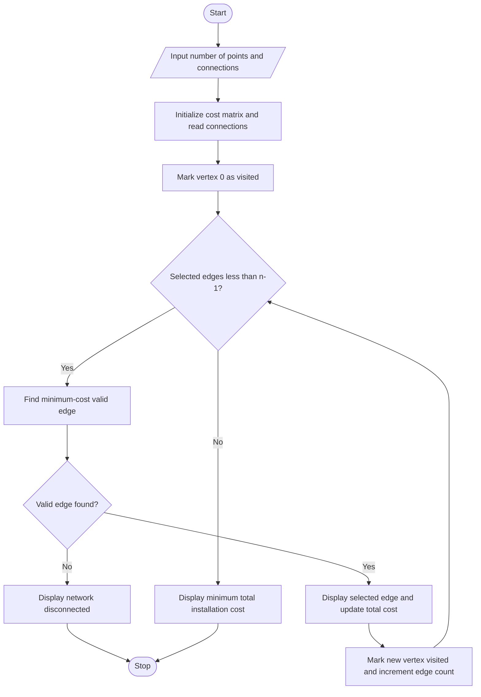

# Agricultural Irrigation Network Using Prim's Algorithm

## 1. Title

Development of an Agricultural Irrigation Network with Water Distribution Points and Weighted Pipe Connections Using Prim's Algorithm to Minimize Installation Cost.

## 2. Problem Statement

In agricultural fields, water needs to be supplied to different distribution points through a network of pipes. Installing pipes between all possible points may increase the total installation cost. Therefore, an efficient method is required to connect all water distribution points while minimizing the overall cost.

This project uses Prim's Algorithm to identify the minimum-cost pipe connections required to connect all distribution points. The network is represented as a weighted, undirected graph, where vertices represent water distribution points and edges represent possible pipe connections with their installation costs.

## 3. Aim

To develop a C++ program using Prim's Algorithm to connect all water distribution points in an agricultural irrigation network with the minimum total pipe installation cost.

## 4. Objectives

1. To understand the representation of a weighted graph.
2. To represent water distribution points as vertices and pipe connections as weighted edges.
3. To accept distribution points and possible pipe connections as input.
4. To implement Prim's Algorithm to find the Minimum Spanning Tree (MST).
5. To identify the minimum-cost pipe connections required to connect all points.
6. To calculate the minimum total installation cost of the irrigation network.

## 5. Theory

A graph is a non-linear data structure consisting of vertices and edges. In this project, vertices represent water distribution points, while edges represent possible pipe connections. Each edge has a weight representing the installation cost of the pipe.

Prim's Algorithm is a greedy algorithm used to find the Minimum Spanning Tree of a connected, weighted, undirected graph. It starts from a selected vertex and repeatedly selects the minimum-cost edge connecting a visited vertex to an unvisited vertex.

The process continues until all vertices are connected. For a connected graph containing \(n\) vertices, the Minimum Spanning Tree contains exactly \(n-1\) edges and does not contain any cycles. This approach helps determine a cost-efficient irrigation network.

## 6. Algorithm

1. Start.
2. Input the number of water distribution points and possible pipe connections.
3. Initialize the cost matrix with infinity to represent unavailable connections.
4. Read the endpoints and installation cost of each pipe connection.
5. Mark vertex 0 as visited.
6. Initialize the selected edge count and total cost to zero.
7. Find the minimum-cost edge connecting a visited vertex to an unvisited vertex.
8. If no valid edge is found, display that the network is disconnected and terminate.
9. Display the selected pipe connection and its cost.
10. Add the selected edge's cost to the total cost and mark the new vertex as visited.
11. Repeat until \(n-1\) edges have been selected.
12. Display the minimum total installation cost.
13. Stop.

## 7. Flowchart

## 8. Conclusion

The Agricultural Irrigation Network project demonstrates the application of Prim's Algorithm to minimize pipe installation costs. By representing water distribution points as vertices and pipe connections as weighted edges, the program identifies a Minimum Spanning Tree that connects all points without cycles.

This project illustrates how graph algorithms can support cost-efficient network planning for agricultural water distribution.